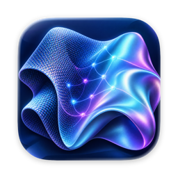
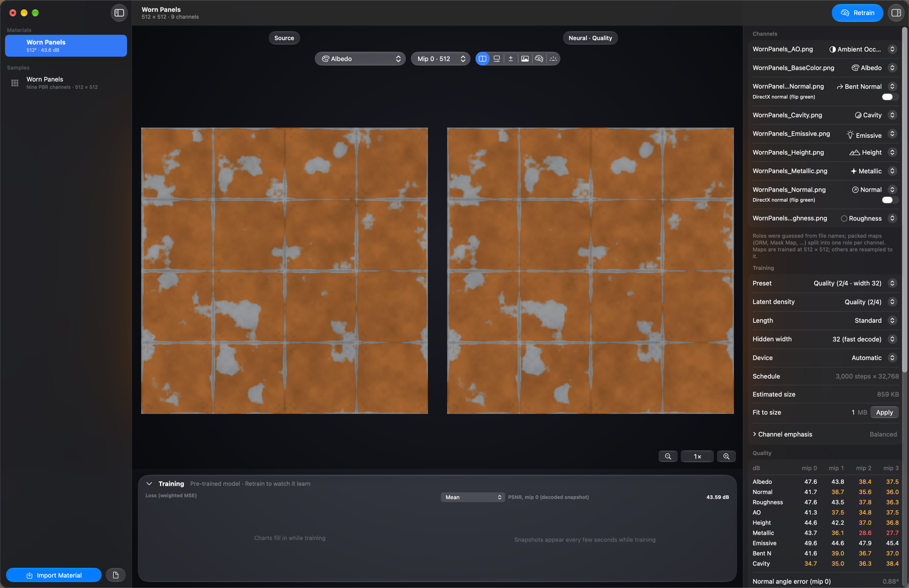
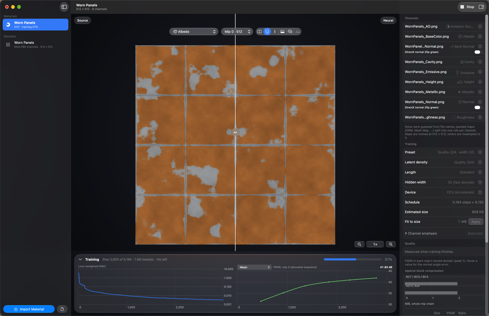
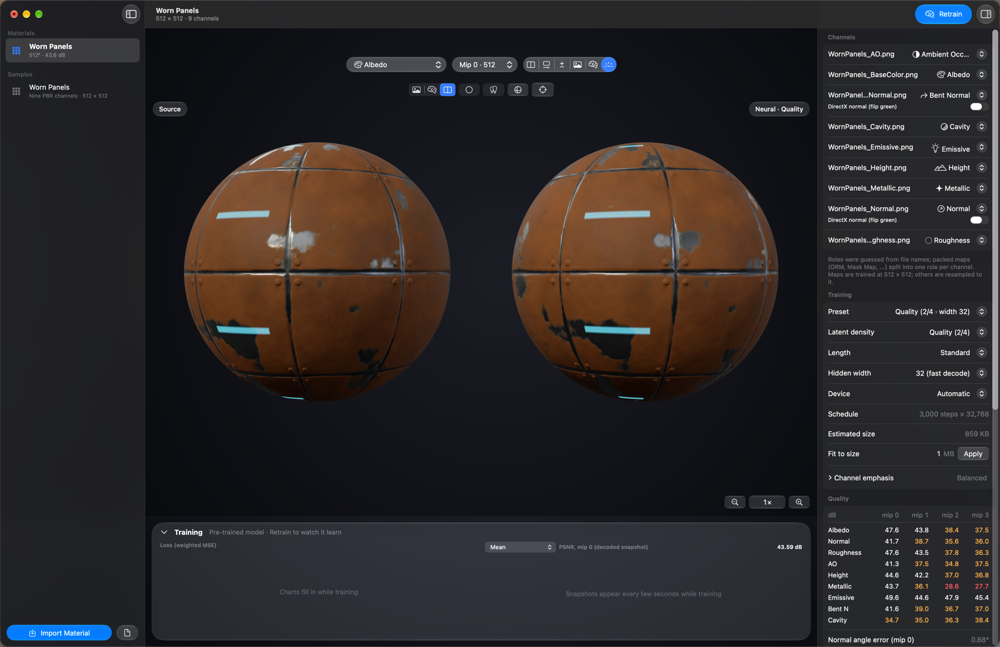
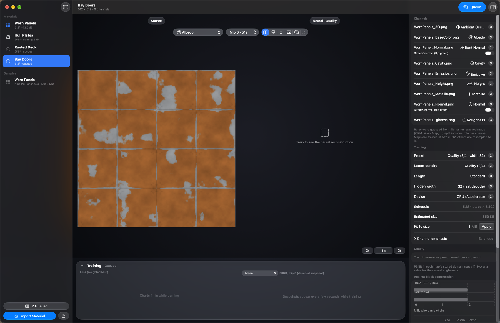

# Neural Texture Studio

Compress whole **PBR material sets** into one small **neural texture**, trained on your Mac. Drop in a folder of maps:
albedo, normal, roughness, AO, height, metallic, emissive, bent normal and cavity. Neural Texture Studio learns all
of them, at every mip, as quantized latent grids plus one tiny network. The result is about 2.4× smaller than the same
set in BC7/BC5, and any texel decodes on its own with a few dozen lines of shader code.

- **Random-access neural compression**, following *Random-Access Neural Compression of Material Textures*
  (Vaidyanathan et al., SIGGRAPH 2023). Every channel is learned jointly, so the network exploits the correlations
  between colour, height, normals and masks that per-texture block compression can't.
- **See exactly what you get.** Live loss and PSNR while it trains. Compare side by side, with a wipe or as an
  amplified difference, zoom to single texels, and read per-channel, per-mip PSNR and the normal-angle error.
- **Honest baselines.** Every material is also encoded as BC7/BC5/BC4 and as ASTC 4×4, so you see size and quality
  side by side.
- **Open format, drop-in decoders.** The `.ntex` container is documented, and the DMG includes a Metal shader and a
  single-file C header so any engine can decode it: per sample in a material shader, or once on load.
- **Fast on Apple silicon.** The whole training step runs on the GPU: about 19M texels/s on a base M5, so a 256²
  material trains in seconds and a 512² one in under a minute.
- **Packed maps and opacity.** ORM, ARM, RMA, MRA, Unity MetallicSmoothness and Mask Map are split per channel
  automatically; base-colour alpha becomes opacity.
- **See it lit.** A 3D preview shows the source and the neural texture side by side on a sphere, cube or tiled plane.
- **Libraries, not just materials.** A batch queue, saved projects, per-channel charts, presets (Quality+, Quality,
  Balanced, Compact), a size-target mode that fits a byte budget, and HTML/CSV library reports.
- **Engine samples.** Unity, Godot and Unreal importers and runtime decoders are in the DMG.
- **Command-line tool included:** `neural-texture demo | scan | train | batch | inspect | decode | export-decoder`.
- **Comes with a sample:** a pre-trained painted-metal material with all nine channels.

## Download
Get **NeuralTextureStudio-1.1.0-macOS.dmg** from
[Releases](https://github.com/theisegoria/neural-texture-studio/releases/latest), open it and drag Neural Texture
Studio to Applications. The `neural-texture` tool, the reference decoders, the engine samples and the sample material are in the DMG.

Requires macOS 27 on Apple silicon. The app is signed with a Developer ID but not notarized. The first time, right-click it in Applications and choose **Open**, then **Open** again.

## Licence
Free to use, including for commercial work. The reference decoder may be shipped in your own engine and games. See
[LICENSE](LICENSE).
